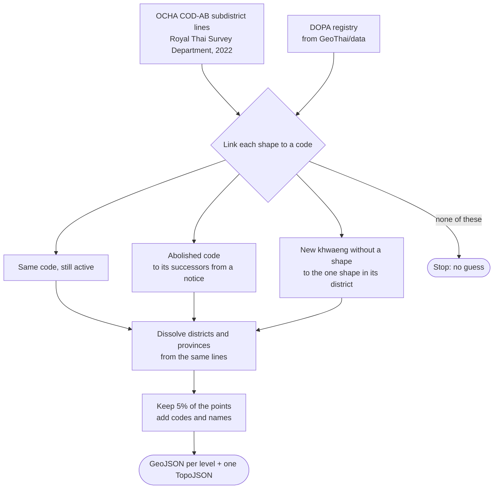

# GeoThai boundaries

The boundaries of every province, district and subdistrict of Thailand, on DOPA codes.

[👉 Releases](https://github.com/GeoThai/boundaries/releases)

## Features

- One shape per province (77), district (928) and subdistrict (7,425 shapes for 7,436 subdistricts)
- The codes and names of [GeoThai/data](https://github.com/GeoThai/data) on every shape, so a map needs no join
- Shared borders: the district and province shapes are dissolved from the subdistrict shapes, so the levels line up exactly
- GeoJSON per level, and one TopoJSON file with all three levels (about 1.5 MB gzipped)
- Simplified to 5% of the points. Small islands stay

## Files

| File                                             | Content                                                   | Shapes |
| ------------------------------------------------ | --------------------------------------------------------- | ------ |
| [`provinces.geojson`](./provinces.geojson)       | Provinces                                                 | 77     |
| [`districts.geojson`](./districts.geojson)       | Districts, with `province_code`                           | 928    |
| [`subdistricts.geojson`](./subdistricts.geojson) | Subdistricts, with `district_code` and `province_code`    | 7,425  |
| [`boundaries.topojson`](./boundaries.topojson)   | The three levels as layers in one file                    | 8,430  |
| [`manifest.json`](./manifest.json)               | Counts, simplification, shared shapes and the source file |        |

Coordinates have 4 decimal places, about 10 m.

A subdistrict shape has these properties:

```json
{
  "code": "100101",
  "codes": ["100101"],
  "district_code": "1001",
  "province_code": "10",
  "name_th": "พระบรมมหาราชวัง",
  "name_en": "Phra Borom Maha Ratchawang"
}
```

`codes` lists the subdistricts that the shape covers. The source lines date from 2022. After that, DOPA cut new khwaeng in Bangkok out of older ones. Seven shapes therefore cover more than one subdistrict. Such a shape has `"code": null` and no name. [`manifest.json`](./manifest.json) lists the seven.

## Usage

Pin a release, so the shapes do not change under you:

```js
const url =
  "https://cdn.jsdelivr.net/gh/GeoThai/boundaries@v2026.10.22/provinces.geojson";
const provinces = await (await fetch(url)).json();
```

To show the subdistricts of one province, filter the features by `province_code`.

## How it is built

A private pipeline builds these files from the OCHA COD-AB lines. The code stays private. These are the steps:



[`manifest.json`](./manifest.json) lists the source file with its URL, SHA-256 and date, and the shapes that cover more than one subdistrict.

## Versions

A version is the date of the build in Thailand, such as `v2026.10.22`. If the source lines and the codes did not change, no release ships.

## License

The shapes are under [CC BY 3.0 IGO](./LICENSE), the license of the source.

The codes and names come from [GeoThai/data](https://github.com/GeoThai/data). That data is under [CC BY 4.0](https://creativecommons.org/licenses/by/4.0/).

Credit "GeoThai, from OCHA COD-AB and the Royal Thai Survey Department" in your work. The full credits are in [`NOTICE`](./NOTICE).
